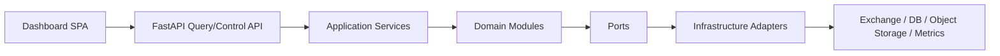
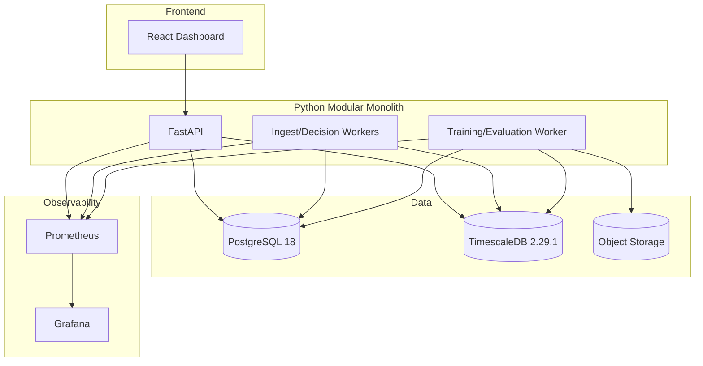

# Architecture Spine — Crypto AI Trader

## Design Paradigm

Crypto AI Trader v1, tek bir Python backend kod tabanında çalışan, bounded-context modüllerle ayrılmış bir **hexagonal modular monolith** olarak tasarlanır. Sistem içi koordinasyon, typed canonical event contract'ler üzerinden **event-driven internal pipeline** ile yapılır; dış dünya ile temas yalnızca adapter ve API port'ları üzerinden olur.

Katman eşlemesi:

- `app/ingest`: Market Data Gateway, WebSocket Manager, Exchange Adapter, Historical/Replay
- `app/contracts`: Canonical event ve entity sözleşmeleri
- `app/processing`: Normalizer, Data Quality Monitor, Scanner, Feature Engineering, Technical Analysis
- `app/decisioning`: Market Regime Detector, Strategy Engine, AI Engine, Opportunity Scoring, Risk Engine
- `app/simulation`: Execution Simulator, Fill Model, Portfolio Simulator, Paper Trading Engine, Backtest Engine
- `app/governance`: Learning Pipeline, Model Registry, Champion/Challenger, Performance Monitor, Alerting
- `app/platform`: API, Authz boundary, Config, Logging, Observability, Persistence adapters

Bu paradigma, MVP'de microservice maliyetini getirmeden net servis sınırları kurar. Ölçekleme ihtiyacı olduğunda process ayrıştırması yapılabilir; modül sınırları korunur.

## Invariants & Rules

### AD-1 — MVP Topology [ADOPTED]

- **Binds:** `all`
- **Prevents:** Erken microservice parçalanması, duplicated orchestration ve bakım maliyeti
- **Rule:** MVP, tek repo ve tek backend deployment artifact'i olan modular monolith olarak kurulur. Ayrı runtime rolleri (`api`, `worker`, `trainer`) aynı kod tabanını paylaşabilir; fakat bağımsız deployable microservice'lere bölünmez.

### AD-2 — Exchange Boundary [ADOPTED]

- **Binds:** `market-data`, `exchange-adapter`, `historical-replay`
- **Prevents:** Exchange-specific schema ve bağlantı davranışının core domain'e sızması
- **Rule:** Exchange'e özel tüm davranış `ExchangeAdapter` port'u arkasında tutulur. Core modüller yalnızca canonical contract'leri görebilir; Binance/Bybit/Coinbase benzeri future adapter'lar aynı interface'i uygular.

### AD-3 — Canonical Event Envelope [ADOPTED]

- **Binds:** `contracts`, `market-data`, `scanner`, `features`, `strategy`, `risk`, `paper-trading`, `backtest`, `observability`
- **Prevents:** Farklı modüllerin aynı olayı farklı şemayla yorumlaması
- **Rule:** Tüm domain event'leri ortak envelope taşır: `event_id`, `event_type`, `schema_version`, `correlation_id`, `causation_id`, `occurred_at`, `received_at`, `source`, `source_type`, `symbol`, `run_mode`, `quality_state`, `payload`. `payload` dışındaki metadata alanları event tipinden bağımsız zorunludur.

### AD-4 — Live/Replay Parity [ADOPTED]

- **Binds:** `historical-replay`, `scanner`, `features`, `regime`, `strategy`, `risk`, `backtest`, `paper-trading`
- **Prevents:** Backtest ile paper trading arasında kod ayrışması ve davranış drift'i
- **Rule:** Live ingest ve replay/historical pipeline aynı canonical event sözleşmesini kullanır. Replay kaynağı yalnızca `source_type=replay` ve `replay_clock` ile ayrılır; feature, strategy, risk, portfolio ve performance kodu mod değiştirmez.

### AD-5 — Data Quality Is a Hard Gate [ADOPTED]

- **Binds:** `data-quality`, `scanner`, `strategy`, `risk`, `paper-trading`, `alerting`
- **Prevents:** Bozuk veriyle sinyal üretimi ve sahte paper result
- **Rule:** `timestamp`, `sequence`, `duplicate`, `missing`, `stale`, `out_of_order`, `invalid_price`, `invalid_volume`, `abnormal_spread` kontrolleri her market event akışında çalışır. Hard failure olduğunda event quarantine edilir, symbol health `unhealthy` olur, etkilenen stratejiler durur, yeni paper order engellenir ve alert üretilir.

### AD-6 — Internal Event Bus First [ADOPTED]

- **Binds:** `market-data`, `processing`, `decisioning`, `simulation`
- **Prevents:** MVP için gereksiz external broker karmaşıklığı
- **Rule:** Event dağıtımı typed in-process bus (`asyncio` queue/topic dispatcher) ile yapılır; durability ihtiyacı için PostgreSQL outbox/inbox tabloları kullanılır. External broker eklemek ancak tek-node sınırı aşıldığında veya bağımsız consumer fleet gerektiğinde değerlendirilir.

### AD-7 — Read Model Ownership

- **Binds:** `storage`, `api`, `dashboard`, `performance`
- **Prevents:** Her modülün başkalarının tablolarını keyfi biçimde mutasyona uğratması
- **Rule:** Raw market data ingest modülü, feature store processing modülü, paper order/fill/position kayıtları simulation modülü, model registry kayıtları governance modülü tarafından yazılır. API ve Dashboard yalnızca query/read-model katmanı üzerinden okur.

### AD-8 — Regime as Independent Service Boundary [ADOPTED]

- **Binds:** `regime`, `strategy`, `risk`, `ai`
- **Prevents:** Rejim mantığının strategy ve AI içine gömülmesi
- **Rule:** Market Regime Detector ayrı modüldür ve `Bull`, `Bear`, `Sideways`, `HighVolatility`, `LowVolatility`, `TransitionUncertain` durumları için skor/confidence üretir. Strategy Engine ve Risk Engine, rejimi yalnızca yayımlanan `MarketRegime` event'i üzerinden tüketir.

### AD-9 — Strategy Plugins Stay Pure [ADOPTED]

- **Binds:** `strategy`
- **Prevents:** Strategy kodunun exchange, DB veya UI ile sıkı bağlanması
- **Rule:** Her strategy plugin yalnızca `FeatureVector`, `MarketRegime`, policy config ve portfolio context üzerinden çalışır. Strategy modülü doğrudan exchange adapter, database session veya dashboard endpoint'i çağırmaz.

### AD-10 — AI Has No Execution Authority [ADOPTED]

- **Binds:** `ai`, `risk`, `paper-trading`
- **Prevents:** AI modelinin doğrudan order üretmesi veya risk bypass etmesi
- **Rule:** AI yalnızca `MarketRegime`, `OpportunityScore`, `ProbabilityEstimate`, `StrategyWeight`, `FeatureImportance` gibi değerlendirme çıktıları üretir. Execution kararı ancak validation ve Risk Engine sonrasında alınır; AI order/paper fill oluşturamaz.

### AD-11 — Risk Engine Is the Final Approval Gate [ADOPTED]

- **Binds:** `risk`, `paper-trading`, `portfolio`, `alerting`
- **Prevents:** Strategy sinyalinin doğrudan paper trading'e akması
- **Rule:** Position sizing, max position, max exposure, max daily loss, max drawdown, consecutive losses, stale data protection, exchange/data failure protection, kill switch ve emergency stop tek Risk Engine modülünde uygulanır. Risk failure varsa pipeline reject eder; fallback yoktur.

### AD-12 — Paper and Future Live Are Separate Execution Boundaries [ADOPTED]

- **Binds:** `paper-trading`, `future-live`
- **Prevents:** V1 içinde gerçek emir yolu oluşması
- **Rule:** V1 yalnızca `ExecutionSimulator` ve `FillModel` kullanır. Future live execution boundary ayrı port ve ayrı permission domain olarak tanımlanır; `Research -> Backtest -> Paper -> Approval -> Live` kapıları strategy veya model kodu tarafından bypass edilemez.

### AD-13 — Portfolio Simulator Is the Source of Trading Truth [ADOPTED]

- **Binds:** `portfolio`, `paper-trading`, `performance`
- **Prevents:** PnL, exposure ve position state'in birden fazla yerde farklı hesaplanması
- **Rule:** Balance, equity, positions, unrealized/realized PnL, fees, exposure ve drawdown yalnızca Portfolio Simulator tarafından türetilir ve yayımlanır. API ve dashboard bu read model'i tüketir; yeniden hesaplayıp overwrite etmez.

### AD-14 — Governed Learning Lifecycle [ADOPTED]

- **Binds:** `learning`, `model-registry`, `champion-challenger`, `performance`
- **Prevents:** Canlı ortamda kontrolsüz self-modifying model davranışı
- **Rule:** Model lifecycle `Candidate -> Tested -> Paper -> Challenger -> Champion -> Retired` durumlarıyla yürür. Promotion için `Train -> Backtest -> Out-of-Sample -> Walk-Forward -> Paper -> Evaluation -> Approval Gate` zinciri zorunludur. Champion değişimi audit log ile kaydedilir ve rollback öncülü tutulur.

### AD-15 — Storage Is Polyglot but Minimal

- **Binds:** `storage`, `backtest`, `replay`, `model-registry`
- **Prevents:** Her veri tipi için ayrı veri tabanı seçilmesi ve operasyon maliyetinin artması
- **Rule:** Operational ve time-series veri için PostgreSQL + TimescaleDB ana veri katmanıdır. Büyük immutable artifact'ler (trained model binaries, backtest bundles, exported replay packs, evaluation reports) object storage'ta tutulur. MVP'de ek NoSQL, search engine veya OLAP sistemi eklenmez.

### AD-16 — API Is Control Plane + Query Plane

- **Binds:** `api`, `dashboard`, `security`
- **Prevents:** Dashboard'ın doğrudan internal worker state'ine bağlanması
- **Rule:** Dashboard yalnızca HTTP API ve push-safe stream endpoint'leri üzerinden veri alır. Emergency stop route'u ayrı permission scope, double-confirmation ve audit trail gerektirir. Internal worker queue/state doğrudan UI'ya açılmaz.

### AD-17 — End-to-End Observability by Correlation ID [ADOPTED]

- **Binds:** `observability`, `alerting`, `api`, `decisioning`, `simulation`
- **Prevents:** Bir market event'ten paper fill'e kadar iz sürülememesi
- **Rule:** Her ingest chain ortak `correlation_id` taşır. Structured log, metrics, traces, risk decision, paper order ve model evaluation kayıtları aynı correlation link'iyle tutulur.

### AD-18 — Environment Separation Is Mandatory [ADOPTED]

- **Binds:** `deployment`, `security`, `testing`
- **Prevents:** Dev/test verisinin paper-production ile karışması
- **Rule:** `development`, `test`, `paper`, `production` ortamları ayrı config, ayrı database/schema namespace ve ayrı artifact path kullanır. V1 production ortamı gerçek trading değil, paper-trading production ortamıdır.

### AD-19 — Failure Defaults to Safe Stop

- **Binds:** `market-data`, `risk`, `api`, `storage`, `simulation`
- **Prevents:** Kısmi arıza durumunda sessiz ve hatalı karar üretimi
- **Rule:** WebSocket disconnect, stale data, missing candles, malformed data, database unavailable, model unavailable, strategy failure, risk engine failure, execution simulator failure ve API failure durumlarında varsayılan tepki yeni paper execution'ı engellemek, scope'u daraltmak, state'i işaretlemek ve alert üretmektir.

### AD-20 — Testability Is an Architectural Constraint

- **Binds:** `contracts`, `strategy`, `risk`, `backtest`, `paper-trading`, `deployment`
- **Prevents:** Daha sonra test edilemeyen sıkı bağlı pipeline
- **Rule:** Her bounded context deterministik fixture/replay input'larıyla test edilebilir olmalıdır. Contract test, replay test, failure injection, backtest regression ve paper trading simulation test'leri doğrudan mimari sözleşmenin parçasıdır.



## Consistency Conventions

| Concern | Convention |
| --- | --- |
| Naming (entities, files, interfaces, events) | Event adları `PascalCase` (`MarketTick`, `RiskDecision`), Python modülleri `snake_case`, adapter port'ları `*Port`, concrete adapter'lar `*Adapter`, policies `*Policy`, read models `*View` |
| Data & formats (ids, dates, error shapes, envelopes) | Tüm zaman alanları UTC ISO-8601 + epoch nanos uyumlu; fiyat/volume `Decimal`; symbol canonical form `BASE/QUOTE`; tüm event'lerde `schema_version`; API error shape `code/message/details/correlation_id` |
| State & cross-cutting (mutation, errors, logging, config, auth) | Domain state yalnızca owner modül tarafından mutate edilir; structured JSON logs zorunlu; config environment-based immutable snapshot'tır; emergency routes audit logged; secrets future-live path için ayrı tutulur |

## Component Responsibilities

| Component | Responsibility | May Depend On | Must Not Depend On |
| --- | --- | --- | --- |
| Market Data Gateway | Public market feeds'i sisteme alır, source health üretir | Exchange Adapter, WebSocket Manager | Strategy, Risk, Dashboard |
| Exchange Adapter | Exchange public API/WebSocket farklarını canonical port'a çevirir | HTTP/WebSocket clients | Strategy, Portfolio, DB schema |
| WebSocket Manager | Connect/reconnect, subscribe/unsubscribe, heartbeat, backoff | Exchange Adapter config | Strategy, Risk |
| Historical Data / Replay | Historical candle/trade/order book replay ve deterministic clock sağlar | Storage, canonical contracts | Live-only code paths |
| Data Normalizer | Exchange payload'larını canonical event'e dönüştürür | Exchange Adapter output | Strategy logic |
| Data Quality Monitor | Validation, health state, quarantine, gap detection | Normalized events | Dashboard rendering logic |
| Market Scanner | Universe tarar, candidate pair listesi ve exclusion reason üretir | Healthy market events, metadata | Exchange-specific schemas |
| Feature Engineering | Versioned feature vector üretir | Canonical events | Exchange APIs |
| Technical Analysis | RSI, EMA, ATR vb. versioned indicators üretir | Candle/feature input | Portfolio mutation |
| Market Regime Detector | Regime state + confidence üretir | FeatureVector | Paper trading execution |
| Strategy Engine | Strategy plugin orchestration ve signal üretimi | FeatureVector, MarketRegime | Exchange, raw DB writes |
| AI Engine | Score, probability, weights, importance üretir | FeatureVector, Regime, StrategySignal | Execution Simulator |
| Opportunity Scoring | Explainable composite score ve rationale üretir | StrategySignal, AI output, liquidity/cost inputs | Direct order creation |
| Risk Engine | Validation gate, position sizing, kill switch, exposure controls | OpportunityScore, PortfolioSnapshot, policy | Exchange, dashboard |
| Portfolio Simulator | Paper balances, positions, PnL, exposure, drawdown state'i taşır | PaperFill, fee/slippage models | Exchange/private account |
| Backtest Engine | Historical evaluation, cost-aware simulation, walk-forward input | Replay, Strategy, Risk, Portfolio | Live adapter connectivity |
| Paper Trading Engine | Realtime/replay signal-to-paper-order pipeline | Strategy, AI, Risk, Execution Simulator | Real exchange order endpoints |
| Execution Simulator | Latency, spread, slippage, partial fill ve fee model uygular | Market data, PaperOrder | Real execution adapters |
| Learning Pipeline | Train/evaluate/promote lifecycle orkestrasyonu | Research data, Backtest, Paper results | Live execution path |
| Model Registry | Model/version/state/metrics/audit saklar | Storage, governance | Strategy direct writes |
| Champion / Challenger | Promotion gate ve rollback kararı yönetir | Model Registry, Performance Monitor | Direct trading |
| Performance Monitor | Strategy/model/regime sonuçlarını izler | Portfolio, Backtest, Paper results | Exchange adapters |
| Alerting | Health/risk/model incidents üretir | Observability, health state | Strategy decisions |
| API | Query/control plane, dashboard data ve operator actions | Read models, control services | Exchange raw clients |
| Dashboard | Operator görünümü ve controls | API only | Internal queues, DB direct writes |
| Database / Storage | Timeseries, relational state, artifacts, audit | Infrastructure adapters | Domain logic |
| Logging / Observability | Logs, metrics, tracing, correlation, alerts | All modules emit | Domain decisions |

## Canonical Contracts

### Common Event Metadata

Her canonical event aşağıdaki zorunlu metadata alanlarını taşır:

| Field | Type | Notes |
| --- | --- | --- |
| `event_id` | UUID | Immutable unique identifier |
| `event_type` | string | Canonical type name |
| `schema_version` | string | Breaking contract versioning |
| `correlation_id` | UUID/string | End-to-end chain id |
| `causation_id` | UUID/string/null | Parent event id |
| `occurred_at` | datetime | Source/exchange or replay event time |
| `received_at` | datetime | System ingest time |
| `source` | string | Exchange, replay dataset, trainer, evaluator |
| `source_type` | enum | `live`, `replay`, `derived`, `system` |
| `symbol` | string/null | Canonical pair, system events for null |
| `run_mode` | enum | `development`, `test`, `paper`, `production-paper` |
| `quality_state` | enum | `healthy`, `degraded`, `unhealthy`, `quarantined` |

### Domain Event Requirements

| Event | Required Payload Fields |
| --- | --- |
| `MarketTick` | `bid`, `ask`, `last`, `mid`, `spread_bps`, `tick_ts` |
| `TradeEvent` | `trade_id`, `side`, `price`, `quantity`, `trade_ts` |
| `OrderBookSnapshot` | `depth`, `bids[]`, `asks[]`, `book_ts`, `sequence_start`, `sequence_end` |
| `OrderBookUpdate` | `bids_delta[]`, `asks_delta[]`, `book_ts`, `sequence` |
| `Candle` | `timeframe`, `open`, `high`, `low`, `close`, `volume`, `vwap`, `closed` |
| `MarketRegime` | `regime`, `confidence`, `scores`, `feature_version`, `detector_version` |
| `FeatureVector` | `feature_version`, `timeframe`, `features{}`, `lookback_window`, `input_refs[]` |
| `StrategySignal` | `strategy_id`, `strategy_version`, `direction`, `entry_thesis`, `entry_price_ref`, `stop_policy`, `take_profit_policy`, `signal_strength` |
| `OpportunityScore` | `score_total`, `score_components{}`, `expected_cost`, `expected_edge`, `confidence`, `actionable` |
| `RiskDecision` | `decision`, `reason_codes[]`, `position_size`, `limits_snapshot`, `kill_switch_state` |
| `PaperOrder` | `paper_order_id`, `side`, `order_type`, `requested_qty`, `requested_price`, `policy_refs[]` |
| `PaperFill` | `paper_order_id`, `fill_id`, `filled_qty`, `avg_fill_price`, `fees`, `slippage`, `latency_ms`, `partial_fill` |
| `Position` | `position_id`, `side`, `qty`, `avg_entry_price`, `mark_price`, `unrealized_pnl`, `stop_price`, `take_profit_price` |
| `PortfolioSnapshot` | `cash_balance`, `equity`, `exposure`, `open_positions`, `realized_pnl`, `unrealized_pnl`, `drawdown` |
| `ModelVersion` | `model_id`, `version`, `status`, `training_range`, `feature_version`, `strategy_version`, `artifact_uri` |
| `ModelEvaluation` | `model_id`, `version`, `dataset_range`, `evaluation_stage`, `metrics{}`, `passed`, `evidence_uri` |

## Storage Policy

### Recommended Mapping

| Data Type | Storage | Why |
| --- | --- | --- |
| Market ticks / candles / trades / order book deltas | TimescaleDB hypertables | Time-series query, retention, downsampling, SQL joins |
| Features / signals / regime outputs / scores | TimescaleDB + relational indexes | Time-window analytics ve audit trail |
| Paper orders / fills / positions / portfolio | PostgreSQL relational tables | ACID state transition ve strong consistency |
| Model metadata / lifecycle / approvals | PostgreSQL relational tables | Governance, joins, auditability |
| Backtest bundles / trained artifacts / evaluation reports | Object storage | Büyük immutable artifact'ler, versioned retention |
| Audit logs | PostgreSQL append-only tables + structured log sink | Forensic traceability |

### SQL vs Time-Series vs Object Storage

| Option | Strength | Weakness | Architecture Decision |
| --- | --- | --- | --- |
| Pure SQL only | En basit operasyon | High-frequency market data için pahalı retention/aggregation | Rejected for raw market scale |
| Dedicated time-series DB + separate SQL | Analitikte güçlü | Ek operasyon ve sync maliyeti | Deferred beyond MVP |
| Postgres + TimescaleDB | Tek operational surface, SQL + hypertable avantajı | Very high-scale multi-node için ileride tuning gerekebilir | **Selected** |
| Object storage only | Ucuz büyük hacim | Query ve transactional state yok | Artifact-only role |

## API Surface

| Group | Purpose |
| --- | --- |
| `/system` | health, runtime roles, adapter status, environment, kill-switch state |
| `/market` | normalized market snapshots, candles, trade flow, data quality |
| `/opportunities` | ranked opportunities, score breakdown, rejection reasons |
| `/strategies` | strategy configs, performance by regime, signal feed |
| `/positions` | paper positions, fills, open/closed trades |
| `/portfolio` | balance, equity, exposure, drawdown, snapshots |
| `/performance` | backtest, paper, regime/model/strategy metrics |
| `/models` | registry, lifecycle, champion/challenger comparisons |
| `/risk` | limits, breaches, decisions, emergency controls |
| `/logs` | recent incident/audit/event summaries, correlation lookup |

## Dashboard Scope

Dashboard, aşağıdaki operator view'larını destekler:

- system health
- market overview
- scanner universe
- opportunities
- active regime state
- strategies and per-regime performance
- paper positions and fills
- PnL and drawdown
- model registry and champion/challenger
- learning pipeline status
- risk state and breaches
- logs and audit events

Emergency stop, yalnızca ayrı permission scope ile erişilir ve audit edilir.

## Structural Seed

```mermaid
flowchart LR
    EX[Exchange / Replay Source]
    WSM[WebSocket Manager]
    ADA[Exchange Adapter]
    NOR[Data Normalizer]
    DQM[Data Quality Monitor]
    BUS[Typed Event Bus]
    SCN[Market Scanner]
    FE[Feature Engineering + TA]
    REG[Market Regime Detector]
    STR[Strategy Engine]
    AI[AI Engine]
    SCO[Opportunity Scoring]
    RSK[Risk Engine]
    PTE[Paper Trading Engine]
    EXE[Execution Simulator]
    PRT[Portfolio Simulator]
    GOV[Learning / Registry / Champion]

    EX --> WSM --> ADA --> NOR --> DQM --> BUS
    BUS --> SCN --> FE --> REG
    FE --> STR
    REG --> STR
    FE --> AI
    STR --> SCO
    AI --> SCO
    SCO --> RSK --> PTE --> EXE --> PRT
    PRT --> GOV
    BUS --> GOV
```





```text
crypto-ai-trader/
  app/
    contracts/        # canonical events, DTOs, schema versioning
    ingest/           # gateway, adapters, websocket, replay
    processing/       # normalizer, quality, scanner, features, TA
    decisioning/      # regime, strategy, AI, scoring, risk
    simulation/       # paper engine, execution simulator, portfolio, backtest
    governance/       # learning pipeline, registry, champion/challenger
    platform/         # API, config, authz, persistence, observability
  tests/
    unit/             # isolated module tests
    integration/      # adapter, storage, API integration
    contracts/        # event/data contract tests
    replay/           # deterministic replay scenarios
    regression/       # backtest and paper trading regression
    failure/          # injected disconnect, stale data, DB/model failures
  artifacts/
    models/           # local dev artifacts
    replays/          # replay bundles
```

## Capability → Architecture Map

| Capability / Area | Lives in | Governed by |
| --- | --- | --- |
| Market Data Gateway | `app/ingest` | AD-1, AD-2, AD-3, AD-5 |
| Exchange Adapter | `app/ingest/adapters` | AD-2, AD-3 |
| WebSocket Manager | `app/ingest` | AD-1, AD-2, AD-19 |
| Historical Data / Replay | `app/ingest/replay` | AD-2, AD-4, AD-20 |
| Data Normalizer | `app/processing` | AD-3, AD-5 |
| Data Quality Monitor | `app/processing` | AD-5, AD-19 |
| Market Scanner | `app/processing` | AD-4, AD-6 |
| Feature Engineering / TA | `app/processing` | AD-4, AD-6 |
| Market Regime Detector | `app/decisioning/regime` | AD-8 |
| Strategy Engine | `app/decisioning/strategy` | AD-9, AD-10 |
| AI Engine | `app/decisioning/ai` | AD-10, AD-14 |
| Opportunity Scoring | `app/decisioning/scoring` | AD-10, AD-11 |
| Risk Engine | `app/decisioning/risk` | AD-11, AD-19 |
| Portfolio Simulator | `app/simulation/portfolio` | AD-13 |
| Backtest Engine | `app/simulation/backtest` | AD-4, AD-12, AD-20 |
| Paper Trading Engine | `app/simulation/paper` | AD-11, AD-12, AD-13 |
| Execution Simulator | `app/simulation/execution` | AD-12, AD-13 |
| Learning Pipeline | `app/governance/learning` | AD-14, AD-20 |
| Model Registry | `app/governance/registry` | AD-14, AD-15 |
| Champion / Challenger | `app/governance/promotion` | AD-14 |
| Performance Monitor | `app/governance/performance` | AD-13, AD-14 |
| Alerting | `app/platform/alerting` | AD-5, AD-17, AD-19 |
| API | `app/platform/api` | AD-16, AD-18 |
| Dashboard | `frontend/` | AD-16 |
| Database / Storage | `app/platform/persistence` | AD-7, AD-15, AD-18 |
| Logging / Observability | `app/platform/observability` | AD-17 |

## Technology Decisions

| Decision | Selected | Reason |
| --- | --- | --- |
| Backend technology | Python-first modular monolith | ML, backtest, feature engineering ve API'yi tek dilde tutup MVP complexity'yi düşürür |
| AI/ML technology | `scikit-learn` tabanlı explainable tabular models, gerektiğinde XGBoost challenger | İlk sürüm için explainability ve reproducibility daha önemli; direct LLM dependency gerekmiyor |
| Database | PostgreSQL 18.4 | Güçlü relational governance ve audit desteği |
| Time-series storage | TimescaleDB 2.29.1 on PostgreSQL | Hypertable, retention, continuous aggregate ve SQL join kolaylığı |
| Event bus | Typed in-process event bus + PostgreSQL outbox | MVP için yeterli, düşük operasyon maliyeti |
| API technology | FastAPI 0.141.1 | Async I/O, schema-first contracts, Python ekosistemi |
| Frontend/dashboard technology | React 19.2.7 + Vite 8.1.5 | Hızlı dashboard iterasyonu ve zengin operator UI |
| Deployment approach | Single backend service + separate frontend artifact; env-separated paper production | MVP topology'ye uygun, kolay gözlemleme |
| Observability | OpenTelemetry conventions + Prometheus 3.13.2 + Grafana 13.1.3 | Correlation, metrics, dashboarding için olgun stack |
| Testing framework | pytest 9.1.1 + replay/contract test suites | Python-first stack ile aynı toolchain |

## Evaluated but Not Selected

### Python vs Node.js

| Option | Strength | Cost | Decision |
| --- | --- | --- | --- |
| Python only backend | ML, research, backtest, API, data processing tek ekosistem | WebSocket orchestration için disiplinli async tasarım gerekir | **Selected** |
| Node.js only backend | Realtime/backend orchestration ve dashboard yakınlığı | ML/backtest/research pipeline'ı parçalar veya zayıflatır | Rejected for MVP |
| Python + Node backend hybrid | Her alan için güçlü araç | İki backend runtime, iki observability hattı, iki deploy surface | Deferred; MVP'de gereksiz complexity |

Sonuç: **backend tarafında hibrit seçilmedi**. Sadece dashboard build/runtime için frontend toolchain doğal olarak Node kullanır; core backend yetkinliği Python'da kalır.

## Failure Modes

| Failure Mode | Detection | System Behavior |
| --- | --- | --- |
| WebSocket disconnected | heartbeat timeout / disconnect event | Source health `degraded`, reconnect loop, symbol scope block, alert |
| Stale market data | freshness threshold breach | New strategy signals blocked, paper orders rejected |
| Missing candles | replay/live completeness check | Feature vector invalidated, affected symbol unhealthy |
| Malformed data | schema/semantic validation fail | Event quarantined, incident logged, no downstream consume |
| Database unavailable | connection/read-write failure | New state mutations paused, safe stop for paper trading, alert |
| Model unavailable | registry/artifact load fail | AI outputs disabled, strategies continue only if policy allows without AI; otherwise reject |
| Strategy failure | plugin exception | Isolate strategy instance, mark failed, do not stop unrelated strategies |
| Risk engine failure | timeout/exception | Fail closed; no paper order creation |
| Execution simulator failure | fill model exception | Order stays rejected/errored; portfolio unchanged |
| API failure | health probe / unhandled exception | UI degraded, internal workers continue, operator alerted |

## Test Architecture Support

- Unit tests: indicator, feature, regime, risk policy, portfolio math
- Integration tests: adapter -> normalizer -> storage, API -> read model
- Replay tests: deterministic historical stream -> same outputs
- Backtest regression: pinned datasets and expected metric ranges
- Data contract tests: all canonical event schemas
- Strategy tests: regime compatibility and signal generation
- Risk tests: limit breaches, kill switch, stale data rejection
- Model evaluation tests: leakage guard, walk-forward stage enforcement
- Paper trading tests: fill/slippage/latency/partial-fill scenarios
- Failure injection: disconnect, malformed payload, DB outage, model load fail

## Deferred

- **Architecture Decision Needed:** İlk exchange veya replay provider kesinleşmedi. Adapter contract hazır; concrete provider seçimi implementation öncesi verilmelidir.
- **Architecture Decision Needed:** İlk symbol universe, timeframe set'i, order-book depth seviyesi ve latency SLO değerleri PRD'de açık bırakılmış durumda.
- **Architecture Decision Needed:** Object storage provider (`local fs`, `MinIO`, `S3-compatible`) seçimi deployment hedefine bağlıdır.
- **Architecture Decision Needed:** Champion promotion thresholds, minimum sample size ve rollback degradation thresholds kesin sayısal eşiklerle belirlenmelidir.
- **Architecture Decision Needed:** Future live spot trading için permission owner, legal/compliance review boundary ve final approval authority tanımlanmalıdır.
- **Open gap from PRD:** Hedef coğrafya ve müşteri-facing product boundary netleşmeden future live veya customer-scoring surface açılmamalıdır.
- **Open gap from brief/PRD:** İlk AI model family ve explainability standardı (pure rules, linear models, tree-based challenger) implementation öncesi sabitlenmelidir; bu mimari yalnızca governance sınırını bağlar.
