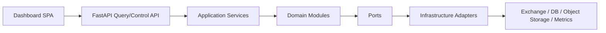
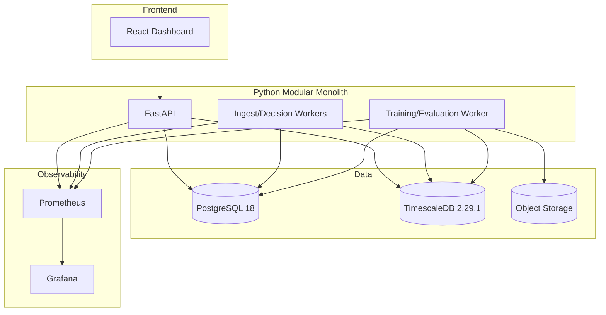

# Architecture Spine — Crypto AI Trader

PRD sınırları **değiştirilmedi**: Spot-only. Futures/leverage/short yok. Gerçek emir, gerçek para, API key yok. Mimari tüm bu güvenlik sınırlarını teknik olarak zorunlu kılar.

## 0. Çelişki / Eksik Karar Notları

- **[Conflict note — brief§17 / PRD§9]** İlk exchange/replay provider, symbol universe, timeframe set, latency SLO, champion terfi eşikleri ve ilk AI family PRD/brief’te açık bırakılmış. Mimari bu kararlara bağlı yerleri **Architecture Decision Needed** olarak bırakır; PRD’nin bunları değiştirmesini beklemez.
- **[Gap note — brief§12]** Future live spot için threat model ve hukuk/uyum incelemesi dış gereksinim; mimari yalnızca ayrı execution boundary ve non-bypassable gate’leri bağlar.
- **[Gap note — PRD§7 NFR-001]** Gecikme SLO’ları sayısal olarak tanımlı değil; mimari yalnızca ölçüm noktalarını ve fail-closed davranışı zorunlu kılar.

## Design Paradigm

Crypto AI Trader v1, tek bir Python backend kod tabanında çalışan, bounded-context modüllerle ayrılmış **hexagonal modular monolith** olarak tasarlanır. Sistem içi koordinasyon typed canonical event contract’ler üzerinden **event-driven internal pipeline** ile yapılır. Dış dünya ile temas yalnızca adapter ve API port’ları üzerinden olur.

Modül/kategori eşleşmesi:

- `app/ingest`: Market Data Gateway, WebSocket Manager, Exchange Adapter, Historical/Replay
- `app/contracts`: Canonical event ve entity sözleşmeleri
- `app/processing`: Normalizer, Data Quality Monitor, Scanner, Feature Engineering, Technical Analysis
- `app/decisioning`: Market Regime Detector, Strategy Engine, AI Engine, Opportunity Scoring, Risk Engine
- `app/simulation`: Execution Simulator, Fill Model, Portfolio Simulator, Paper Trading Engine, Backtest Engine
- `app/governance`: Learning Pipeline, Model Registry, Champion/Challenger, Performance Monitor, Alerting
- `app/platform`: API, Authz boundary, Config, Logging, Observability, Persistence adapters

MVP’de microservice yok; runtime rolleri (`api`, `worker`, `trainer`) aynı kodu paylaşır, bağımsız process olarak çalıştırılabilir.



## Invariants & Rules

Her AD; **Binds → Prevents → Rule** üçlüsüyle yazılmıştır.

### AD-1 — MVP Topology [ADOPTED]

- **Binds:** `all`
- **Prevents:** Erken microservice parçalanması, duplicated orchestration, deploy/observability maliyeti
- **Rule:** MVP tek repo ve tek backend deployment artifact’i olan **modular monolith** olarak kurulur. Ayrı runtime rolleri (`api`, `worker`, `trainer`) aynı kod tabanını paylaşabilir; bağımsız deployable microservice’lere bölünmez.

### AD-2 — Exchange Boundary [ADOPTED]

- **Binds:** `market-data`, `exchange-adapter`, `historical-replay`
- **Prevents:** Exchange-specific schema ve bağlantı davranışının core domain’e sızması
- **Rule:** Exchange’e özel tüm davranış `ExchangeAdapter` port’u arkasında tutulur. Core modüller yalnızca canonical contract’leri görebilir; Binance/Bybit/Coinbase vb. gelecekteki adapter’lar aynı interface’i uygular.

### AD-3 — Canonical Event Envelope [ADOPTED]

- **Binds:** `contracts`, `market-data`, `scanner`, `features`, `strategy`, `risk`, `paper-trading`, `backtest`, `observability`
- **Prevents:** Farklı modüllerin aynı olayı farklı şema ile yorumlaması
- **Rule:** Tüm domain event’leri ortak envelope taşır: `event_id`, `event_type`, `schema_version`, `correlation_id`, `causation_id`, `occurred_at`, `received_at`, `source`, `source_type`, `symbol`, `run_mode`, `quality_state`, `payload`. Metadata alanları zorunludur.

### AD-4 — Live/Replay Parity [ADOPTED]

- **Binds:** `historical-replay`, `scanner`, `features`, `regime`, `strategy`, `risk`, `backtest`, `paper-trading`
- **Prevents:** Backtest ile paper trading arasında kod ayrışması, davranış drift’i
- **Rule:** Live ingest ve replay/historical pipeline aynı canonical event sözleşmesini kullanır. Replay kaynağı `source_type=replay` ve `replay_clock` ile ayrılır; feature, strategy, risk, portfolio ve performance kodu mod değiştirmez.

### AD-5 — Data Quality Is a Hard Gate [ADOPTED]

- **Binds:** `data-quality`, `scanner`, `strategy`, `risk`, `paper-trading`, `alerting`
- **Prevents:** Bozuk veriyle yanlış sinyal üretimi, sahte paper result
- **Rule:** `timestamp`, `sequence`, `duplicate`, `missing`, `stale`, `out_of_order`, `invalid_price`, `invalid_volume`, `abnormal_spread` kontrolleri her market event akışında çalışır. Hard failure → event quarantine, symbol health `unhealthy`, etkilenen stratejiler stop, yeni paper order engelle, alert üret.

### AD-6 — Internal Event Bus First [ADOPTED]

- **Binds:** `market-data`, `processing`, `decisioning`, `simulation`
- **Prevents:** MVP için gereksiz external broker karmaşıklığı
- **Rule:** Event dağıtımı typed in-process bus (`asyncio` dispatcher) ile yapılır; durability ihtiyacı için PostgreSQL outbox/inbox tabloları kullanılır. External broker ancak tek-node sınırı aşıldığında değerlendirilir.

### AD-7 — Read Model Ownership and Mutation Boundaries

- **Binds:** `storage`, `api`, `dashboard`, `performance`, `simulation`, `governance`, `processing`
- **Prevents:** Aynı entity’yi birden fazla modülün keyfi mutate etmesi; çift yazarlı tablo yarışları
- **Rule:** Yazım sahipliği tekildir: (1) Raw market data → `ingest`; (2) Feature store / technical indicators → `processing`; (3) `PaperOrder`, `PaperFill`, `Position`, `PortfolioSnapshot` → SADECE `Portfolio Simulator` (simulation alt modülü); `Backtest Engine` bu kayıtları doğrudan yazamaz, gerekirse Portfolio Simulator komutlarını çağırır (AD-24). (4) Model registry, lifecycle state, audit transitions → SADECE `Model Registry` (governance); diğer modüller registry komutları kullanır (AD-23). API ve Dashboard yalnızca read-model katmanı üzerinden okur.

### AD-8 — Regime as Independent Service Boundary [ADOPTED]

- **Binds:** `regime`, `strategy`, `risk`, `ai`
- **Prevents:** Rejim mantığının strategy ve AI içine gömülmesi
- **Rule:** Market Regime Detector ayrı modüldür; `Bull`, `Bear`, `Sideways`, `HighVolatility`, `LowVolatility`, `TransitionUncertain` durumları için skor/confidence üretir. Strategy ve Risk, rejimi yalnızca yayımlanan `MarketRegime` event’i üzerinden tüketir.

### AD-9 — Strategy Plugins Stay Pure [ADOPTED]

- **Binds:** `strategy`
- **Prevents:** Strategy kodunun exchange, DB veya UI ile sıkı bağlanması
- **Rule:** Her strategy plugin yalnızca `FeatureVector`, `MarketRegime`, policy config ve portfolio context üzerinden çalışır. Strategy doğrudan adapter/DB/UI çağırmaz.

### AD-10 — AI Has No Execution Authority [ADOPTED]

- **Binds:** `ai`, `risk`, `paper-trading`
- **Prevents:** AI’ın doğrudan order üretmesi veya risk bypass etmesi
- **Rule:** AI yalnızca `MarketRegime`, `OpportunityScore`, `ProbabilityEstimate`, `StrategyWeight`, `FeatureImportance` gibi assessment çıktıları üretir. Execution ancak validation + Risk Engine sonrası alınır; AI paper order/fill oluşturamaz.

### AD-11 — Risk Engine Is the Final Approval Gate [ADOPTED]

- **Binds:** `risk`, `paper-trading`, `portfolio`, `alerting`
- **Prevents:** Strategy sinyalinin doğrudan paper trading’e akması
- **Rule:** Position sizing, max position, max exposure, max daily loss, max drawdown, consecutive losses, stale/exchange-failure protection, kill switch ve emergency stop tek Risk Engine modülünde uygulanır. Risk failure varsa pipeline reject eder; fallback yoktur.

### AD-12 — Paper and Future Live Are Separate Execution Boundaries [ADOPTED]

- **Binds:** `paper-trading`, `future-live`
- **Prevents:** V1 içinde gerçek emir yolu oluşması, kapıların bypass edilmesi
- **Rule:** V1 yalnızca `ExecutionSimulator` ve `FillModel` kullanır. Future live boundary ayrı port ve ayrı permission domain’dir. `Research → Backtest → Paper → Approval → Live` kapıları strategy/model kodu tarafından bypass edilemez.

### AD-13 — Portfolio Simulator Is the Source of Trading Truth [ADOPTED]

- **Binds:** `portfolio`, `paper-trading`, `backtest`, `performance`
- **Prevents:** PnL, exposure ve position state’in birden fazla yerde farklı hesaplanması; backtest ve paper trading’in çelişen pozisyon/PnL üretmesi
- **Rule:** Balance, equity, positions, unrealized/realized PnL, fees, exposure, drawdown yalnızca Portfolio Simulator tarafından türetilir. Backtest Engine kendi state’ini **saklamaz**; pozisyon/fill/PnL üretmek için zorunlu olarak Portfolio Simulator’u replay içinde çağırır ve çıktılarını Portfolio Simulator’ın tablolarına yazdırır (tek yazar). API/Dashboard bu read model’i tüketir; yeniden hesaplayıp overwrite etmez.

### AD-14 — Governed Learning Lifecycle [ADOPTED]

- **Binds:** `learning`, `model-registry`, `champion-challenger`, `performance`
- **Prevents:** Canlı ortamda kontrolsüz self-modifying model davranışı
- **Rule:** Lifecycle `Candidate → Tested → Paper → Challenger → Champion → Retired`. Promotion için `Train → Backtest → Out-of-Sample → Walk-Forward → Paper → Evaluation → Approval Gate` zinciri zorunlu. Champion değişimi audit log ile kaydedilir; rollback mümkün olmalı. **Sadece Model Registry modülü `ModelVersion.status` alanını mutate edebilir.** Learning Pipeline ve Champion-Challenger modülleri durumu değiştirmek için registry API’si çağırır; doğrudan UPDATE yapmazlar ve `active_champion_per_strategy` gibi ikinci bir doğruluk kaynağı tablo tutamazlar.

### AD-15 — Storage Is Polyglot but Minimal

- **Binds:** `storage`, `backtest`, `replay`, `model-registry`
- **Prevents:** Her veri tipi için ayrı DB seçmek → operasyon maliyeti
- **Rule:** Operational + time-series → PostgreSQL 18 + TimescaleDB. Büyük immutable artifact’lar (model binaries, backtest bundles, replay packs, evaluation reports) → object storage. MVP’de ek NoSQL/OLAP/search yok.

### AD-16 — API Is Control Plane + Query Plane

- **Binds:** `api`, `dashboard`, `security`
- **Prevents:** Dashboard’ın doğrudan internal worker state’ine bağlanması
- **Rule:** Dashboard yalnızca HTTP API ve push-safe stream endpoint’leri üzerinden veri alır. Emergency stop ayrı permission scope, double-confirmation ve audit trail gerektirir. Internal queue/state doğrudan UI’a açılmaz.

### AD-17 — End-to-End Observability by Correlation ID [ADOPTED]

- **Binds:** `observability`, `alerting`, `api`, `decisioning`, `simulation`
- **Prevents:** Event → decision → paper fill zincirinin izlenememesi
- **Rule:** Her ingest chain ortak `correlation_id` taşır. Structured log, metrics, traces, risk decision, paper order ve model evaluation aynı correlation link’iyle tutulur.

### AD-18 — Environment Separation Is Mandatory [ADOPTED]

- **Binds:** `deployment`, `security`, `testing`
- **Prevents:** Dev/test verisinin paper-production ile karışması
- **Rule:** `development`, `test`, `paper`, `production` ortamları ayrı config, ayrı DB/schema namespace ve ayrı artifact path kullanır. V1 production **paper-trading production** ortamıdır; gerçek trading değildir.

### AD-19 — Failure Defaults to Safe Stop

- **Binds:** `market-data`, `risk`, `api`, `storage`, `simulation`
- **Prevents:** Kısmi arıza durumunda sessiz, hatalı karar üretimi
- **Rule:** WebSocket disconnect, stale data, missing candles, malformed data, DB unavailable, model unavailable, strategy failure, risk engine failure, execution simulator failure ve API failure → yeni paper execution engelle, scope daralt, state işaretle, alert üret.

### AD-20 — Testability Is an Architectural Constraint

- **Binds:** `contracts`, `strategy`, `risk`, `backtest`, `paper-trading`, `deployment`
- **Prevents:** Daha sonra test edilemeyen sıkı bağlı pipeline
- **Rule:** Her bounded context deterministik fixture/replay input’larıyla test edilebilir olmalıdır. Contract test, replay test, failure injection, backtest regression ve paper simulation test mimari sözleşmesidir.

### AD-21 — Single Owner for Symbol Eligibility State

- **Binds:** `data-quality`, `scanner`, `risk`, `paper-trading`
- **Prevents:** Aynı sembol için 3 ayrı eligibility/health/blocked state tutulması ve çelişen kararlar
- **Rule:** “Sembol ticarete uygun mu?” tek bir aggregate `SymbolEligibilityView` tarafından ve tek bir “coordinator” API tarafından yönetilir. Data Quality, Scanner, Risk her biri kendi nedenini submit edebilir; ama final aggregated eligibility state yalnızca bu coordinator tarafından yazılır ve tek tabloda tutulur. Herhangi bir module doğrudan eligibility state mutate edemez; niyetini event/command olarak publish eder.

### AD-22 — FeatureVector Shape Is a Versioned, Typed Contract

- **Binds:** `features`, `regime`, `strategy`, `ai`
- **Prevents:** Aynı `feature_version` için farklı `features{}` shape’leri; runtime KeyError veya sessiz skor hatası
- **Rule:** `FeatureVector.features{}` her `feature_version` için ayrı bir typed schema taşır; anahtar seti, tipleri (flat `Dict[str, Decimal|float]`), boş değer izni, minimum/gözlenen maksimum ve measurement unit sözleşmesi `contracts/feature_versions` altında kilitlenir. Regime/AI/Strategy yalnızca sözleşmeli anahtarları okuyabilir; ekstra anahtar veya farklı tip contract test’inde başarısız olur.

### AD-23 — Model Lifecycle State Mutates Only Through Registry Commands

- **Binds:** `learning`, `registry`, `champion-challenger`, `governance`
- **Prevents:** 3 ayrı modülün aynı status alanını UPDATE etmesi; audit kaybı, atlanmış lifecycle kapıları
- **Rule:** `ModelVersion.status` geçişleri yalnızca Model Registry’nin komut interface’i (`request_transition(model_id, target_state, evidence_ref, approver_ref)`) üzerinden yapılır. Learning Pipeline ve Champion-Challenger modülleri kanıt derler ama doğrudan status güncellemez.

### AD-24 — Backtest Does Not Own Positions/PnL Tables

- **Binds:** `backtest`, `portfolio`, `simulation`
- **Prevents:** Backtest ve Paper engine’in ayrı PnL/Position kaynakları tutması; raporların birbiriyle çelişmesi
- **Rule:** Backtest Engine, backtest run’ını bağlamsal `run_id` ile yürütür ama `positions`/`portfolio_snapshots`/`fills` kayıtlarını Portfolio Simulator üzerinden üretir. Backtest modülü yalnızca run metadata, artifact linkleri ve evaluasyon metrikleri tablolarını yazar; trading state tablolarını doğrudan yazmaz.

### AD-25 — Strategy Plugin Interface Receives Typed Context, Not Raw Dicts

- **Binds:** `strategy`, `features`, `regime`, `ai`
- **Prevents:** Farklı strategy plugin’lerinin aynı event’den beklentilerinin ayrışması; sürüm uyumsuzluğu
- **Rule:** `StrategyPlugin.evaluate()` girdisi olarak Pydantic/attrs benzeri typed `StrategyContext` alır; `FeatureVector`, `MarketRegime`, `OpportunityScoreComponentPolicy`, `PortfolioContext`, `EligibilityContext` bu context’in üyeleridir. Strategy sözleşmesi (tip, nullability, alanlar) contract test’lerinde yer alır.


## 1. Genel Mimarî — Bileşen Sorumlulukları

| Component | Responsibility |
| --- | --- |
| Market Data Gateway | Public market feeds’i sisteme alır, source health üretir |
| Exchange Adapter | Exchange public API/WebSocket farklarını canonical port’a çevirir |
| WebSocket Manager | Connect/reconnect, subscribe/unsubscribe, heartbeat, backoff |
| Historical Data / Replay | Historical candle/trade/order book replay ve deterministic clock |
| Data Normalizer | Exchange payload’larını canonical event’e dönüştürür |
| Data Quality Monitor | Validation, health state, quarantine, gap detection |
| Market Scanner | Universe tarar, candidate list + exclusion reason üretir |
| Feature Engineering | Versioned feature vector üretir |
| Technical Analysis | RSI, EMA, ATR vb. versioned indicators |
| Market Regime Detector | Regime state + confidence üretir |
| Strategy Engine | Strategy plugin orchestration ve signal üretimi |
| AI Engine | Score, probability, weights, importance üretir |
| Opportunity Scoring | Explainable composite score ve rationale |
| Risk Engine | Validation gate, position sizing, kill switch, exposure controls |
| Portfolio Simulator | Paper balances, positions, PnL, exposure, drawdown |
| Backtest Engine | Historical evaluation, cost-aware simulation, walk-forward input |
| Paper Trading Engine | Realtime/replay signal-to-paper-order pipeline |
| Execution Simulator | Latency, spread, slippage, partial fill, fee model |
| Learning Pipeline | Train/evaluate/promote lifecycle orkestrasyonu |
| Model Registry | Model/version/state/metrics/audit saklar |
| Champion / Challenger | Promotion gate ve rollback kararı yönetir |
| Performance Monitor | Strategy/model/regime sonuçlarını izler |
| Alerting | Health/risk/model incidents üretir |
| API | Query/control plane, dashboard data ve operator actions |
| Dashboard | Operator görünümü ve controls (yalnızca API üzerinden) |
| Database / Storage | Timeseries, relational state, artifacts, audit |
| Logging / Observability | Structured logs, metrics, traces, correlation, alerts |

## 2. Exchange Adapter Interface

`ExchangeAdapter` port’u (sınır, teknik değil sözleşme seviyesi):

- `connect() / disconnect()` — kanal yaşam döngüsü
- `subscribe(channels, symbols)`; `unsubscribe(...)`
- `get_ticker(symbol)`; `stream_ticker(symbols)`
- `get_order_book(symbol, depth)`; `stream_order_book(symbols, depth)`
- `stream_trades(symbols)`
- `get_candles(symbol, timeframe, start, end)`; `stream_candles(...)` (eğer sağlayıcı destekliyorsa)
- `get_historical(trades|candles|order_book, range, filters)`
- `health()` — connection status, latency, last message age
- `metadata(symbols|null)` — symbol, contract size, filters, status

Concrete adapter ör. `BinanceSpotAdapter`, `BybitSpotAdapter`, `CoinbaseSpotAdapter`, `ReplayBundleAdapter`. Her biri aynı interface’i uygular; çıktı normalize edilir. **Adapter’ın dışında exchange-specific type/symbol/channel ismi taşınmaz.**

## 3. Market Data Pipeline

Akış:

```
Exchange/Replay
  → WebSocket Manager
  → Exchange Adapter
  → Data Normalizer
  → Data Quality Monitor (validation)
  → Typed Event Bus / Outbox Stream
  → Consumers (Scanner, Features, Regime, Storage Writer)
```

### Data Validation Checklist

- `timestamp` — future drift, zero/null, çok eski drift
- `sequence` — boşluk/tekrar/geri dönüş (order book delta’ları için)
- `duplicate` — event_id veya (trade_id,symbol) veya sequence çakışması
- `missing` — candle completeness, trade tick completeness
- `stale data` — freshness threshold breach
- `out-of-order event` — replay/live sequence/ts monotonicity
- `invalid price` — <= 0, NaN, abnormal tick size violation
- `invalid volume` — <= 0, NaN, lot/step rule violation
- `abnormal spread` — spread_bps aşırı yükselme (likidite uyarısı)

### Fail-safe Davranış

`BAD DATA`:

1. Event’i `quarantined` olarak işaretle; downstream tüketme.
2. İlgili sembol `quality_state=degraded/unhealthy`.
3. Etkilenen strateji örneklerini askıya al (AD-5).
4. Yeni paper order onaylama (AD-11).
5. Alert + correlation ID + audit log (AD-17).
6. Recovery: doğrulanmış health reset’i sonrasında sembol yeniden eligible olur.

## 4. Event / Data Contracts

### Ortak Metadata (Zorunlu)

| Field | Type | Notes |
| --- | --- | --- |
| `event_id` | UUID | Immutable benzersiz |
| `event_type` | string | Canonical type name |
| `schema_version` | string | Breaking contract versioning |
| `correlation_id` | UUID/string | Zincir kimliği |
| `causation_id` | UUID/string\|null | Parent olay kimliği |
| `occurred_at` | datetime UTC | Exchange/replay olay zamanı |
| `received_at` | datetime UTC | Sisteme alınma zamanı |
| `source` | string | Exchange, replay dataset, evaluator |
| `source_type` | enum | `live`, `replay`, `derived`, `system` |
| `symbol` | string\|null | Canonical `BASE/QUOTE`; system olayları için null |
| `run_mode` | enum | `development`, `test`, `paper`, `production-paper` |
| `quality_state` | enum | `healthy`, `degraded`, `unhealthy`, `quarantined` |

### Başlıca Domain Event’ler ve Zorunlu Payload Alanları

| Event | Required Payload Fields |
| --- | --- |
| `MarketTick` | `bid`, `ask`, `last`, `mid`, `spread_bps`, `tick_ts` |
| `TradeEvent` | `trade_id`, `side`, `price`, `quantity`, `trade_ts` |
| `OrderBookSnapshot` | `depth`, `bids[]`, `asks[]`, `book_ts`, `sequence_start`, `sequence_end` |
| `OrderBookUpdate` | `bids_delta[]`, `asks_delta[]`, `book_ts`, `sequence` |
| `Candle` | `timeframe`, `open`, `high`, `low`, `close`, `volume`, `vwap`, `closed` |
| `MarketRegime` | `regime`, `confidence`, `scores{}`, `feature_version`, `detector_version` |
| `FeatureVector` | `feature_version`, `timeframe`, `features{}` (AD-22 uyarınca flat `Dict[str, Decimal|float]`, schema-versioned anahtar seti), `lookback_window`, `input_refs[]` |
| `StrategySignal` | `strategy_id`, `strategy_version`, `direction` (v1 long-only), `entry_thesis`, `entry_price_ref`, `stop_policy`, `take_profit_policy`, `signal_strength` |
| `OpportunityScore` | `score_total`, `score_components{}`, `expected_cost`, `expected_edge`, `confidence`, `actionable` |
| `RiskDecision` | `decision` (approve/reject), `reason_codes[]`, `position_size`, `limits_snapshot`, `kill_switch_state` |
| `PaperOrder` | `paper_order_id`, `side`, `order_type`, `requested_qty`, `requested_price`, `policy_refs[]` |
| `PaperFill` | `paper_order_id`, `fill_id`, `filled_qty`, `avg_fill_price`, `fees`, `slippage`, `latency_ms`, `partial_fill` |
| `Position` | `position_id`, `side` (v1 long), `qty`, `avg_entry_price`, `mark_price`, `unrealized_pnl`, `stop_price`, `take_profit_price` |
| `PortfolioSnapshot` | `cash_balance`, `equity`, `exposure`, `open_positions`, `realized_pnl`, `unrealized_pnl`, `drawdown` |
| `ModelVersion` | `model_id`, `version`, `status`, `training_range`, `feature_version`, `strategy_version`, `artifact_uri` |
| `ModelEvaluation` | `model_id`, `version`, `dataset_range`, `evaluation_stage`, `metrics{}`, `passed`, `evidence_uri` |

## 5. Realtime + Historical (Parity)

- Live ve replay aynı canonical envelope ve payload şemasını kullanır.
- Replay modu: `source_type=replay` + `replay_clock` (sistem saati yerine deterministik sanal saat).
- Tüketici kodda `if live` / `if replay` branch’i **strategist/feature/risk/portfolio katmanında yoktur**.
- Backtest engine replay’ı yürütür; paper engine ise aynı bus üzerinden live/replay stream’i tüketir.
- Amaç: backtest sonuçları ile paper trading sonuçları arasında kod farkıyla oluşan drift’i minimize etmek.

## 6. Market Regime

- Rejim detector bağımsız modül (AD-8); input `FeatureVector`, output `MarketRegime`.
- Desteklenen durumlar: `Bull`, `Bear`, `Sideways`, `HighVolatility`, `LowVolatility`, `TransitionUncertain`.
- Her durum skor + confidence + sürüm bilgisi ile taşınır.
- `TransitionUncertain` güvenlik durumu: strateji eligibility düşer, risk daha sıkı (FR-016/FR-018).
- Strategy engine ve risk engine rejimi yalnızca event bus üzerinden okur; inline hesaplama yok.

## 7. Strategy Engine

- Plug-in mimarisi; her strateji `StrategyPlugin` interface’ini uygular.
- MVP’de aktif: `TrendFollowing`, `Momentum` (FR-027).
- Gelecekte kaydedilebilecek adaylar: `Breakout`, `MeanReversion`, `VolumeSpike`, `OrderBookImbalance`, `Volatility`, `AIAdaptive`.
- Her plugin şunları deklare eder: gerekli input’lar, uygun olduğu rejimler, giriş/çıkış/geçersiz kılma kuralları, config sürümü, ürettiği rationale.
- **Strategy kodu doğrudan exchange veya DB konuşmaz** (AD-9). Sadece `FeatureVector`, `MarketRegime`, policy context ve portfolio snapshot okur.

## 8. AI Engine

AI yetkileri:

- regime classification (desteği)
- opportunity scoring
- probability estimation
- strategy weighting
- feature importance

**AI’ın doğrudan order üretme veya risk bypass etme yetkisi yoktur** (AD-10, FR-032).

Akış:

```
FeatureVector + MarketRegime + StrategySignal
  → AI Engine
  → (scores, probabilities, weights, importance)
  → Validation layer
  → Risk Engine
  → Execution Decision (paper only in v1)
```

## 9. Adaptive Learning (Kontrollü)

Mimari:

```
Data (time-split, versioned)
  → Feature Engineering (versioned)
  → Training (versioned model)
  → Backtest (cost-aware, leakage checks)
  → Out-of-Sample evaluation
  → Walk-Forward validation
  → Paper Trading evaluation (shadow)
  → Evaluation / metrics aggregation
  → Challenger
  → Promotion Gate (metrics + sample + regime coverage + human)
  → Champion
```

Champion/Challenger kuralları (AD-14):

- Challenger izole değerlendirilir; Champion’ı kendiliğinden replace etmez.
- Promotion için karşılaştırma: net return, max drawdown, Sharpe, Sortino, profit factor, stability, trade count, fees, slippage, rejim bazlı performans (FR-038).
- Zayıf OOS/WF, yüksek drawdown, yetersiz örneklem, maliyet varsayımlarında bozulma → reddet (FR-039).
- Champion değişimi audit log ile kaydedilir.
- Rollback: belirgin bozulmada önceki champion’a veya observe-only duruma dön.

Model Registry alanları: `model_id`, `version`, `training data range`, `feature_version`, `strategy_version`, `parameters`, `metrics`, `evaluation results`, `status`, `artifact_uri`, `approval`, `predecessor`, `created_at`.

## 10. Backtest Engine

Hesaba katılması gerekenler (AD-4/AD-12):

- historical input (replay contract üzerinden)
- fees (maker/taker, withdrawal değil işlem ücreti)
- slippage (volatilite/likiditeye bağlı eğri)
- latency (execution delay simülasyonu)
- spread (gerçekçi giriş/çıkış)
- position sizing (risk limits + allocation policy)
- stop loss / take profit
- portfolio constraints (pozisyon sayısı, exposure, uzun pozisyon only)

Leakage kontrolleri (FR-042/FR-043):

- time-ordered, non-overlapping partitions
- feature set sürümüne kilitlenmiş lookback pencereleri
- look-ahead bias checker (gelecekten bilgi içeren feature/skip test)
- survivorship bias, delisting bias notları (kapsanan evren şeffaf)
- split contamination ve target leakage kontrolleri

## 11. Paper Trading

Gerçek exchange emri **GÖNDERİLMEZ** (AD-12, FR-047).

Pipeline (AD-11/FR-049):

```
Signal
  → Validation (data eligibility, regime, contract)
  → Risk Engine (position sizing, limits, killswitch)
  → Execution Simulator (order lifecycle model)
  → Fill Model (spread/slippage/latency/partial fill/fees)
  → Portfolio Simulator (positions, PnL, exposure)
```

Fill model faktörleri (FR-048):

- spread bazlı fiyat düzeltmesi
- volatilite/order size/sıra depth bağlı slippage eğrisi
- taker/maker fee modeli (configurable)
- order oluşum anı ile market erişim anı arası latency modeli
- partial fill desteği (kısmi dolum, çoklu fill event’i)

## 12. Risk Engine

Bağımsız modüldür (AD-11). En az:

- position sizing (vol/equity/stop odaklı)
- max position size (sembol başına)
- max exposure (portföy toplam / ağırlıklandırma)
- max open positions (eş zamanlı açık pozisyon sınırı)
- max daily loss
- max drawdown
- consecutive losses limiti
- stop loss / take profit policy uygulama
- kill switch (master toggle)
- emergency stop (manually triggered)
- stale data protection
- exchange/data failure protection (FR-055)
- long-only ve spot-only zorunlu kısıt (v1)

Risk Engine bir sinyali reddedebilir; bu durum pipeline sonlanır, reason_code kaydedilir, audit edilir.

## 13. Portfolio Simulator

Takip ettikleri: `balance`, `equity`, `positions`, `unrealized PnL`, `realized PnL`, `fees`, `exposure`, `drawdown` (AD-13). Ayrıca:

- her pozisyon için cost basis, lot/adım uyumu, stop/take policy referansları
- per-event portfolio snapshot (API/dashboard read model’i)
- realized/unrealized P&L decomposition, fee accounting

Portfolio state’in tek yazıcısı simulation modülüdür (AD-7).

## 14. Model Registry

Durumlar: `Candidate → Tested → Paper → Challenger → Champion → Retired`.

Özellikler (AD-14, FR-036/FR-037/FR-038/FR-039/FR-040/FR-041):

- her geçişte evidence (rapor/metrik/bağımsız denetim)
- Champion → Challenger geçişinde audit log (approver, zaman, rationale, prior state, evidence link)
- her sürüm için predecessor tutulur; rollback doğrudan possible
- geçersiz kılma / oto-promote kapalıdır; human gate zorunlu (v1)

## 15. Storage

### Karşılaştırma

| Seçenek | Güçlü Yan | Zayıf Yan | Karar |
| --- | --- | --- | --- |
| Sadece SQL (Postgres) | En basit operasyon | High-frequency market data için pahalı retention/aggregation | Reddedildi (raw ölçek) |
| Özel time-series DB + SQL ayrı | Analitik güç | Ek operasyon, sync maliyeti | MVP sonrası degerlendir |
| **PostgreSQL + TimescaleDB** | Tek operational surface, SQL + hypertable, continuous aggregate | Çok yüksek çoklu node ölçekte tuning gerekebilir | **SEÇİLDİ** |
| Object storage only | Ucuz, büyük hacim | Transactional state + zengin query yok | Sadece artifact |

### Önerilen Eşleştirme

| Veri | Storage | Neden |
| --- | --- | --- |
| market ticks / candles / trades / order book deltas | TimescaleDB hypertables | Time-series query, retention, downsampling, SQL join |
| features / signals / regime outputs / scores | TimescaleDB + relational index | Time-window analytics ve audit trail |
| paper orders / fills / positions / portfolio | PostgreSQL relational | ACID state transition, strong consistency |
| model metadata / lifecycle / approvals | PostgreSQL relational | Governance, joins, auditability |
| backtest bundles / trained artifacts / eval raporları | Object storage | Büyük immutable artifact, versioned retention |
| audit logs | PostgreSQL append-only + structured log sink | Adli izlenebilirlik |

## 16. Technology Stack

### Python vs Node.js Karşılaştırması

| Seçenek | Güçlü Yan | Zayıf Yan | Karar |
| --- | --- | --- | --- |
| **Python only backend** | ML/research/backtest/data processing/API tek ekosistem; reproducibility daha güçlü | WebSocket orchestration için disiplinli async tasarım gerekir | **SEÇİLDİ (MVP)** |
| Node.js only backend | Realtime orchestration ve dashboard yakınlığı | ML/backtest/research pipeline’ını parçalar veya zayıflatır | Reddedildi |
| Python + Node hibrit backend | Her alan için güçlü araç | İki runtime, iki observability hattı, iki deploy surface | MVP’de gereksiz complexity → ertelendi |

### Seçilen Stack (AD-6/AD-15/AD-16/AD-17/AD-18/AD-20)

| Karar | Seçilen | Neden |
| --- | --- | --- |
| Backend teknolojisi | **Python 3.14.6 (tek dil)** | ML, backtest, feature, API aynı ekosistem; MVP complexity düşük |
| AI/ML teknolojisi | `scikit-learn` (explainable tabular), `XGBoost` (challenger opsiyonel) | Açıklanabilirlik ve reproducibility ilk öncelik; LLM bağımlılığı yok v1 |
| Database | **PostgreSQL 18.4** | Relational governance ve audit desteği |
| Time-series storage | **TimescaleDB 2.29.1 (PostgreSQL üstünde)** | Hypertable, retention, continuous aggregate + SQL join kolaylığı |
| Event bus | Typed in-process bus + **PostgreSQL outbox/inbox** | MVP yeterli, düşük operasyon maliyeti |
| API teknolojisi | **FastAPI 0.141.1** | Async I/O, schema-first, Python ekosistemi |
| Frontend/Dashboard | **React 19.2.7 + Vite 8.1.5** | Zengin operatör UI ve hızlı iterasyon |
| Deployment yaklaşımı | Single backend service + ayrı frontend artifact; env-separated paper production | MVP topology’ye uygun, kolay gözlemleme |
| Observability | **OpenTelemetry** conventions + **Prometheus 3.13.2** + **Grafana 13.1.1** | Correlation, metrics, dashboarding için olgun stack |
| Testing framework | **pytest 9.1.1** + replay/contract suite | Python-first stack ile aynı toolchain |

## 17. API

Önerilen endpoint grupları (AD-16):

| Grup | Amaç |
| --- | --- |
| `/system` | health, runtime rolleri, adapter status, env, kill-switch state |
| `/market` | normalized market snapshots, candles, trade flow, data quality |
| `/opportunities` | ranked opportunities, score breakdown, rejection reasons |
| `/strategies` | strategy configs, per-regime performance, signal feed |
| `/positions` | paper positions, fills, open/closed trades |
| `/portfolio` | balance, equity, exposure, drawdown, snapshots |
| `/performance` | backtest, paper, regime/model/strategy metrics |
| `/models` | registry, lifecycle, champion/challenger karşılaştırmaları |
| `/risk` | limits, breaches, decisions, emergency controls (scope: restricted) |
| `/logs` | olay/insident/audit özetleri, correlation lookup |

`/risk` altındaki `kill-switch`, `emergency-stop` ayrı permission + double confirmation + audit trail ister.

## 18. Dashboard

İçermesi gereken view’lar (FR-057):

- system health (adapter, worker, storage, AI, risk)
- market overview (takip edilen evren, spread/volatilite haritası)
- scanner (her sembol için dahil/exclude nedeni)
- opportunities (sıralı, açıklanabilir skor bileşenleri)
- regime state (aktif + confidence + geçmiş)
- strategies (aktif plugin’ler, rejim uyumu, per-strategy performans)
- paper positions + fills
- P&L + drawdown (gross vs net, maliyet ayrıştırması)
- model registry + champion/challenger karşılaştırması
- learning pipeline durumu
- risk state, limit ihlalleri, kill switch
- logs ve correlation-trail viewer

**Emergency stop erişimi:** ayrı güvenlik kontrolü, ayrı scope, double-confirm, audit log (AD-16).

## 19. Observability

- **Structured logs:** JSON, correlation_id/causation_id, schema_version, run_mode
- **Metrics:** ingest latency, decision latency, paper fill latency, data quality counters, strategy signal rate, risk reject rate, model eval counts, drawdown/pnl gauges
- **Tracing:** ingest → normalizer → scanner → features → regime → strategy → AI → scoring → risk → paper fill zinciri
- **Latency monitoring:** ingest-to-decision, ingest-to-fill, DB p99, adapter reconnect time
- **Data quality monitoring:** stale rate, duplicate/gap/malformed counts, spread anomalileri
- **Model monitoring:** input drift, prediction stability, champion-challenger delta
- **Strategy monitoring:** per-regime return, win rate, fee/slippage impact
- **Risk alerts:** drawdown, daily loss, consecutive losses, symbol health, kill switch
- **System health:** env, adapter, API, DB, artifact storage, runtime rolleri

Tüm bunlar AD-17 uyarınca `correlation_id` ile uçtan uca izlenebilir olmalı.

## 20. Security

v1 sert sınırlar (AD-12, FR-061):

- hiçbir API key/secret/token kaynak kodunda, config’de, log’da, test fixture’da yok
- `trading_permission` (gerçek emir) default `disabled`. Aktive olursa sadece future phase’te.
- `emergency_stop` ayrı permission + audit

Gelecekte mimariye dahil edilecek katmanlar:

- secrets manager (key rotasyonu, env ayrımı)
- environment separation (AD-18 zaten bağlar)
- least privilege (component bazlı yetki, ör. AI sadece read, risk can mutate policy state değil kendi decision state’i)
- API permission isolation (ör. data read, scoring, risk policy, registry approve, emergency stop ayrı scope’lar)
- audit log (champion promosyonu, risk override, emergency action, model rollback)
- authentication/authorization (future çok kullanıcılı faz)
- trading permission ayrı güvenlik katmanı (onay zinciri + kill switch test koşulu)

## 21. Failure Modes

| Mod | Detection | Varsayılan Davranış (fail-safe) |
| --- | --- | --- |
| WebSocket disconnected | heartbeat timeout, disconnect event | source health `degraded`, reconnect loop, symbol scope block, alert |
| Stale market data | freshness threshold breach | yeni strategy sinyalleri block, paper order reject (AD-5 + AD-11) |
| Missing candles | replay/live completeness check | feature vector invalid, affected symbol unhealthy, alert |
| Malformed data | schema/semantic validation fail | event quarantine, incident log, downstream consume yok |
| Database unavailable | connection/read-write failure | yeni state mutation’ları duraklat, paper trading safe stop, alert |
| Model unavailable | registry/artifact load fail | AI output’ları devre dışı; politika izin veriyorsa non-AI stratejiler devam, yoksa reject |
| Strategy failure | plugin exception | tek strategy instance’ı izole et, diğerlerini durdurma; affected symbol/strateji fail |
| Risk engine failure | timeout/exception | Fail closed; hiçbir paper order create edilemez (AD-11) |
| Execution simulator failure | fill model exception | Order rejected/errored; portfolio unchanged, incident log |
| API failure | health probe / unhandled exception | UI degraded; internal workers varsa devam eder; operatör alert |

## 22. Deployment Ortamları

`Development → Test → Paper → Production` (AD-18):

- **Development:** developer machine, yerel data/DB, küçük replay fixtures
- **Test:** otomatik contract/replay/regression/failure-injection; veri izole schema’da
- **Paper:** canlı/replay paper trading, artifact promotion gate’leri ve audit açık
- **Production (v1):** **paper-trading production** ortamıdır. Gerçek emir/gerçek para/YETKİSİZ.
- Gelecek faz “Live Spot Production” ayrı faz, ayrı inceleme, ayrı onaydır; bu PRD/architecture onu ENABLE etmez.

## 23. Test Architecture

Mimari desteklemesi gereken test kategorileri (AD-20):

- unit tests: indicator, feature math, regime state transition, risk policy, portfolio math
- integration tests: adapter → normalizer → storage; API → read model
- replay tests: deterministik historical stream → aynı outputs
- backtest regression: sabit dataset + metrik aralıkları
- data contract tests: tüm canonical event şemaları + envelope zorunlu alanları
- strategy tests: rejim uyumu ve sinyal üretim doğruluğu
- risk tests: limit ihlalleri, kill switch, stale data reject
- model evaluation tests: leakage guard, walk-forward stage zorlaması
- paper trading tests: fill/slippage/latency/partial-fill senaryoları
- failure injection: disconnect, malformed payload, DB outage, model load fail, risk timeout

## 24. Security / Trading Gates

- Kapı zinciri: `Research → Backtest → Paper → Approval → Live`
- Her kapıda artifact, metrik seti ve audit kaydı zorunlu.
- Bu kapılar strategy veya AI kodu tarafından bypass edilemez (AD-12).
- Gerçek emir sistemi ayrı **execution boundary** olarak tasarlanır (gelecek faz); v1’de boundary var ama adapter gerçek execution endpoint’ine sahip değildir ve trading permission kapalıdır.
- Execution boundary’ye geçmeden önce tehdit modeli, hukuk/uyum incelemesi, kill switch sert testleri ve açık insan onayı gerekir.

## 25. Mimari Kararlar (Özet)

| Karar | Seçim | Gerekçe |
| --- | --- | --- |
| Backend technology | Python 3.14.6, modular monolith | ML/backtest/research/API tek ekosistem; MVP complexity minimum |
| AI/ML technology | scikit-learn (+ XGBoost challenger ops.) | Explainability + reproducibility öncelik |
| Database | PostgreSQL 18.4 | Governance, audit, ACID |
| Time-series storage | TimescaleDB 2.29.1 | Hypertable + SQL birleşimi, tek operasyon surface |
| Event bus | In-process typed bus + PG outbox | Broker operasyon maliyeti yok MVP’de |
| API technology | FastAPI 0.141.1 | Async + schema-first, Python uyumu |
| Frontend/Dashboard | React 19.2.7 + Vite 8.1.5 | Zengin operatör UI, hızlı iterasyon |
| Deployment yaklaşımı | Single backend + frontend artifact; env-separated paper production | MVP scale’e uygun, kolay gözlemleme |
| Observability | OpenTelemetry + Prometheus 3.13.2 + Grafana 13.1.1 | Correlation + metrics + mature dashboarding |
| Testing framework | pytest 9.1.1 + replay/contract suite | Python-first toolchain, reproducibility |

**Architecture Decision Needed (henüz kesinleşmemişler):**

1. İlk exchange veya replay provider, lisans modeli ve symbol normalization sözleşmesi
2. Başlangıç symbol universe, quote currency, timeframe set’i, order-book depth, historical lookback
3. Latency/availability/recovery/kabul edilebilir data-loss SLO’ları (sayısal)
4. Trend Following ve Momentum kesin kurallar + rejim eligibility + başarı/başarısızlık eşikleri
5. İlk AI model family ve explainability kalibrasyon standardı
6. Score weights, confidence thresholds, net-of-cost expectation eşiği, risk defaults (sayısal)
7. Paper fill/fee/slippage/latency/partial-fill varsayımları (hangi market referansı)
8. Champion promotion için min örnek, metrik eşikleri, rejim kapsamı, approver
9. Rollback degradation eşikleri ve emergency stop/kill switch sahibi
10. Object storage provider (local fs / MinIO / S3 uyumlu)
11. Future live spot için permission owner, hukuk/uyum sınırı, final onay makamı
12. Hedef coğrafya, müşteri yüzü boundary, hukuk/uyum incelemesi scope’u

## 26. MVP Architecture (Dikey Dilim)

MVP akışı (gereksiz complexity olmadan):

```
Market Data (replay bundle / public data adapter, anahtarsız)
  → Scanner (universe eligibility + liquidity/vol/spread filtreleri)
  → Features + TA (OHLCV/volume/volatility/selected indicators)
  → Regime (6-state scoring)
  → Strategy: Trend Following + Momentum (v1 active)
  → Opportunity Scoring (explainable composite)
  → AI (scoring/weighting/importance, NO execution yetkisi)
  → Risk Engine (position sizing/limits/kill switch/final approve)
  → Backtest Engine (historical, fee/slippage/latency/spread, leakage checks)
  → Paper Trading Engine (Execution Simulator + Fill Model, NO real orders)
  → Performance Monitor (PnL, drawdown, fee impact, regime/strategy/model breakdown)
  → Model Evaluation / Registry / Champion-Challenger evidence
```

MVP’de **modular monolith + ayrı ML/training process** yaklaşımı: aynı repo, aynı contract; `trainer` rolü ayrı process, async job olarak çalışır. Microservices yok. Security sınırları MVP’de tek yerde uygulanır: risk ve execution boundary.

## Consistency Conventions

| Concern | Convention |
| --- | --- |
| İsimlendirme (entities, dosyalar, arayüzler) | Event adları `PascalCase`, Python modülleri `snake_case`, port’lar `*Port`, concrete adapter’lar `*Adapter`, policy’ler `*Policy`, read modeller `*View` |
| Veri ve formatlar (ids, dates, error shapes) | Zaman alanları UTC ISO-8601 + epoch nanos; fiyat/volume `Decimal`; symbol `BASE/QUOTE`; tüm event’lerde `schema_version`; API error `code/message/details/correlation_id` |
| State ve cross-cutting | Domain state yalnızca owner modül tarafından mutate edilir; structured JSON logs zorunlu; config immutable env snapshot; emergency routes audit logged; future secrets ayrı tutulur |

## Structural Seed

```mermaid
flowchart LR
    EX[Exchange / Replay Source]
    WSM[WebSocket Manager]
    ADA[Exchange Adapter]
    NOR[Data Normalizer]
    DQM[Data Quality Monitor]
    BUS[Typed Event Bus]
    SCN[Market Scanner]
    FE[Feature Engineering + TA]
    REG[Market Regime Detector]
    STR[Strategy Engine]
    AI[AI Engine]
    SCO[Opportunity Scoring]
    RSK[Risk Engine]
    PTE[Paper Trading Engine]
    EXE[Execution Simulator]
    PRT[Portfolio Simulator]
    GOV[Learning / Registry / Champion]

    EX --> WSM --> ADA --> NOR --> DQM --> BUS
    BUS --> SCN --> FE --> REG
    FE --> STR
    REG --> STR
    FE --> AI
    STR --> SCO
    AI --> SCO
    SCO --> RSK --> PTE --> EXE --> PRT
    PRT --> GOV
    BUS --> GOV
```





```text
crypto-ai-trader/
  app/
    contracts/        # canonical events, DTOlar, schema versioning
    ingest/           # gateway, adapters, websocket, replay
    processing/       # normalizer, quality, scanner, features, TA
    decisioning/      # regime, strategy, AI, scoring, risk
    simulation/       # paper engine, execution simulator, portfolio, backtest
    governance/       # learning pipeline, registry, champion/challenger
    platform/         # API, config, authz boundary, persistence, observability
  frontend/
    dashboard/        # React/Vite
  tests/
    unit/
    integration/
    contracts/
    replay/
    regression/
    failure/
  artifacts/
    models/
    replays/
```

## Capability → Architecture Map

| Capability / Alan | Lives in | Governed by |
| --- | --- | --- |
| Market Data Gateway | `app/ingest` | AD-1, AD-2, AD-3, AD-5 |
| Exchange Adapter | `app/ingest/adapters` | AD-2, AD-3 |
| WebSocket Manager | `app/ingest` | AD-1, AD-2, AD-19 |
| Historical Data / Replay | `app/ingest/replay` | AD-2, AD-4, AD-20 |
| Data Normalizer | `app/processing` | AD-3, AD-5 |
| Data Quality Monitor | `app/processing` | AD-5, AD-19 |
| Market Scanner | `app/processing` | AD-4, AD-6 |
| Feature Engineering / TA | `app/processing` | AD-4, AD-6 |
| Market Regime Detector | `app/decisioning/regime` | AD-8 |
| Strategy Engine | `app/decisioning/strategy` | AD-9 |
| AI Engine | `app/decisioning/ai` | AD-10, AD-14 |
| Opportunity Scoring | `app/decisioning/scoring` | AD-10, AD-11 |
| Risk Engine | `app/decisioning/risk` | AD-11, AD-19 |
| Portfolio Simulator | `app/simulation/portfolio` | AD-13 |
| Backtest Engine | `app/simulation/backtest` | AD-4, AD-12, AD-20 |
| Paper Trading Engine | `app/simulation/paper` | AD-11, AD-12, AD-13 |
| Execution Simulator | `app/simulation/execution` | AD-12, AD-13 |
| Learning Pipeline | `app/governance/learning` | AD-14, AD-20 |
| Model Registry | `app/governance/registry` | AD-14, AD-15 |
| Champion / Challenger | `app/governance/promotion` | AD-14 |
| Performance Monitor | `app/governance/performance` | AD-13, AD-14 |
| Alerting | `app/platform/alerting` | AD-5, AD-17, AD-19 |
| API | `app/platform/api` | AD-16, AD-18 |
| Dashboard | `frontend/dashboard` | AD-16 |
| Database / Storage | `app/platform/persistence` | AD-7, AD-15, AD-18 |
| Logging / Observability | `app/platform/observability` | AD-17 |

## Stack (seed)

| Name | Version |
| --- | --- |
| Python | 3.14.6 |
| FastAPI | 0.141.1 |
| PostgreSQL | 18.4 |
| TimescaleDB | 2.29.1 |
| React | 19.2.7 |
| Vite | 8.1.5 |
| Prometheus | 3.13.2 |
| Grafana | 13.1.1 |
| pytest | 9.1.1 |
| scikit-learn | latest stable (MVP implementation sırasında pin) |
| XGBoost | latest stable (challenger track, opsiyonel) |
| OpenTelemetry | latest stable Python/JS SDK |

## Deferred

- İlk exchange/replay provider seçimi (concrete adapter)
- Symbol universe, timeframe set, order-book depth, lookback
- Latency/availability SLO sayısalları
- Trend/Momentum kesin kurallar + başarı eşikleri
- İlk AI ailesi ve explainability standardı
- Score/confidence/risk sayısal varsayımlar
- Fill/fee/slippage/latency/partial-fill referans eğrileri
- Promote/rollback sayısal eşikleri ve approver
- Object storage provider
- Future live spot için hukuk/uyum boundary ve onay makamı
- Hedef coğrafya ve müşteri yüzü product boundary

